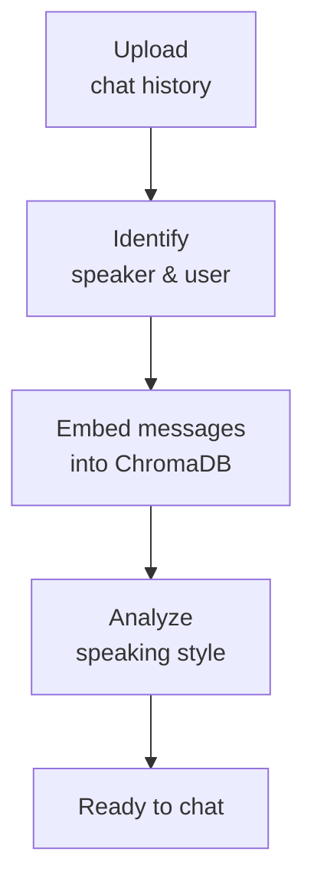
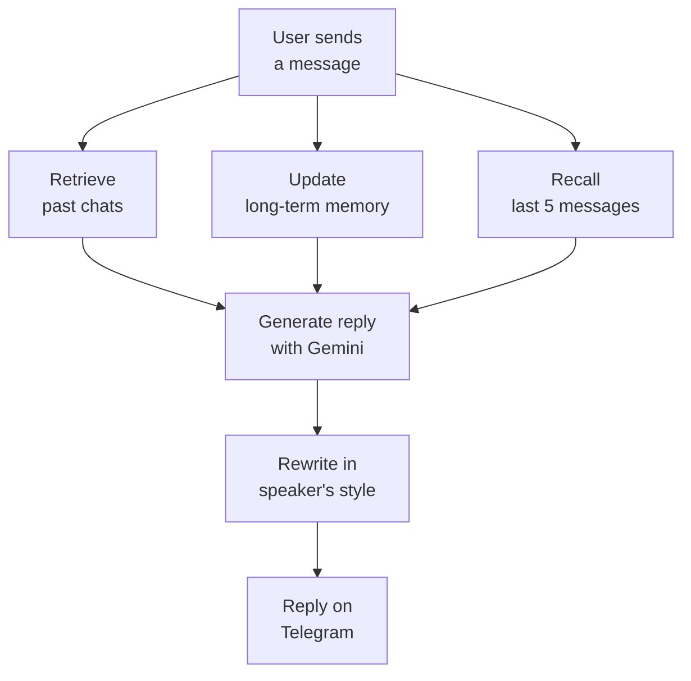

# Compai - Companion Chatbot
This project implements a Retrieval-Augmented Generation (RAG) Chatbot using Gemini AI, ChromaDB, and Gemini Embeddings, integrated seamlessly with Telegram Bot. It provides a natural and engaging conversational experience with an affectionate and emotionally resonant communication style, making it feel like a caring conversational partner.

---

> [Demo](https://youtu.be/54qxNNAtHT0)

> [Presentation Slide](https://www.canva.com/design/DAGfoSN9y6A/i_AvmPdiUjaudQNl5wpehA/edit?utm_content=DAGfoSN9y6A&utm_campaign=designshare&utm_medium=link2&utm_source=sharebutton)

## Features
#### 1. Embeddings & LLM:

- Utilizes Gemini Embeddings (gemini-embedding-001) for efficient vector representation of text.
- Leverages Gemini (gemini-3.5-flash-lite) for natural language generation.
  
#### 2. Advanced Memorization

- Short-term memory: Stores the last five messages in a double-ended queue (deque) for maintaining conversational flow.
- Long-term memory: Extracts key facts (e.g., age, preferences, dislikes) from past conversations and stores them in a structured key-value table, allowing for more relevant and contextual responses.

#### 3. Intelligent Conversation Retrieval

- Retrieves similar vectors from past conversations using ChromaDB, ensuring context-aware interactions.
- Merges retrieved historical context with key-value stored facts to enhance response accuracy.

#### 4. Personalized Speaker Style Adaptation

- Analyzes writing style, tone, and emoji usage to tailor responses.
- Ensures answers mimic the user’s natural conversational flow, making the chatbot more engaging and emotionally intelligent.

#### 5. Telegram Integration

- Allows seamless chat history uploads to automatically recognize user and speaker IDs.
- Provides real-time interaction with continuous context-awareness.

## How It Works
#### 1. Load Conversation History:

- Upload conversations file from telegram.
- Loads JSON conversations in chunks using orjson for fast processing.
#### 2. ChromaDB Initialization:

- Initializes a ChromaDB collection and dynamically adds conversation data with vector embeddings.
#### 3. Speaker Style Analysis:

- Analyzes the speaker's writing style, tone, and emoji usage to personalize responses.
#### 4. Context Retrieval with ChromaDB
- When a user sends a message, the system retrieves similar past conversations using vector embeddings.
- It dynamically combines:
    - Retrieved historical context from ChromaDB.
    - Key-value structured data (e.g., user preferences).
    - The last five messages stored in short-term memory.
#### 5. Response Generation
- Using the Gemini API, the chatbot synthesizes a response that:
    - Integrates retrieved context.
    - Matches the user’s communication style.
    - Feels natural and personalized.

## Architecture
#### Uploading Chat History


#### Answering a Message

---
## Installation
#### 1. Clone the repository:
```
git clone https://github.com/FLYIH/Compai.git
cd Compai
```
#### 2. Create a virtual environment (Python 3.11 or 3.12 recommended):
```
python3 -m venv venv
source venv/bin/activate  # On Windows PowerShell: .\venv\Scripts\Activate.ps1
```
#### 3. Install required dependencies:
```
python -m pip install -r requirements.txt
```
## API Key Setup
This project uses Google Gemini API and Telegram Bot Token for seamless integration.

- Gemini API Key: Obtain from [Google AI Studio](https://aistudio.google.com/apikey)

- Telegram Bot Token: Create a bot using BotFather on Telegram.
    - Open Telegram and search for ``@BotFather``.
    - Start a chat and use the command:
      ```
      /newbot
      ```
    - Follow the instructions to set a name and username for your bot.

- create a ``.env`` file in the root directory:
    ```
    GEMINI_API_KEY=your_gemini_api_key_here
    TG_BOT_TOKEN=your_telegram_bot_token_here
    ```

## Running the Chatbot
#### 1. Activate the virtual environment:
```
source venv/bin/activate  # On Windows PowerShell: .\venv\Scripts\Activate.ps1
```
#### 2. Run the chatbot:
```
python main.py
```
#### 3. Interact with the Chatbot on Telegram:

- Start chatting:
    - Export chat history in JSON format.
    - Send the exported JSON file as a document attachment.
    - The chatbot will respond with context-aware and emotionally resonant replies.

